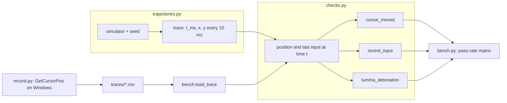

# human-presence-checks

Some Windows malware stays inactive in a sandbox until it sees a user. This repository replays three published user-presence checks against cursor traces from five candidate user simulators and from a recorded human, and measures which simulators each check rejects.

It answers a narrow question: what must a cursor simulator do to get past these three checks? It does not run malware, a sandbox or a virtual machine.

## Checks

| Check | Rule as published | Source |
|---|---|---|
| `cursor_moved` | `GetCursorPos`, `Sleep(2000)`, `GetCursorPos`; same position means no user | Check Point Evasions, Human-like behavior, 2.1 |
| `recent_input` | `Sleep(30000)`, then more than 6000 ms since the last input (`GetLastInputInfo`) means no user | Check Point Evasions, Human-like behavior, 2.5 |
| `lumma_detonation` | 5 cursor reads 50 ms apart; every read must differ from the previous one and every angle between consecutive movement vectors must be under 45 degrees; otherwise start over | Outpost24 analysis of LummaC2 v4.0, November 2023 |

## Data flow



## Results

`python bench.py --seeds 100`, 30 s traces:

| simulator | runs | cursor moved in 2 s | input in last 6 s at 30 s | LummaC2 passed in 30 s | LummaC2 median wait |
|---|---|---|---|---|---|
| idle | 100 | 0/100 | 0/100 | 0/100 | never |
| jumps | 100 | 100/100 | 100/100 | 0/100 | never |
| random_walk | 100 | 100/100 | 100/100 | 84/100 | 9.9 s |
| linear | 100 | 100/100 | 100/100 | 100/100 | 0.2 s |
| human_like | 100 | 100/100 | 100/100 | 100/100 | 0.2 s |

- `jumps` (a random `SetCursorPos` once per second) beats the two simple checks but never LummaC2: it never produces 5 distinct reads in 200 ms.
- `random_walk` (3 px jitter every 10 ms) is irregular but not smooth, so a set of reads passes the 45 degree test only by chance, after about 10 s.
- `linear` passes LummaC2 at once, since a straight line has 0 degree turns. The check rejects jitter, not scripts.
- `human_like` (curved Bezier moves with ease-in and ease-out, pauses of 0.1 to 1.5 s) passes all three.

A simulator specification therefore has to name the checks it must defeat: "irregular movement" fails LummaC2, and "passes LummaC2" says nothing against a check on constant speed.

## Run

Python 3.12, standard library only.

```bash
pip install -r requirements-dev.txt
pytest -q
ruff check . && ruff format --check .
python bench.py --seeds 100
```

Recorded baseline, Windows only:

```bash
python record.py --out traces/human.csv --seconds 35   # use the mouse normally
python bench.py --trace traces/human.csv
```

## Limits

- The checks are reimplemented from public write-ups, not from samples, and are not validated against real malware. LummaC2's retry loop is modelled as back-to-back attempts.
- Only the cursor counts as input; keyboard input, recent documents, browser history and installed software, which other checks read, are not modelled.
- The simulators run in Python against a model of `GetCursorPos`. Injecting the input into a guest, from an agent inside it or from the hypervisor, is out of scope.
- A sampled trace stands in for real-time reads, so timing effects such as scheduling jitter in a loaded VM are absent.
- The `human_like` parameters are chosen by hand, not fitted to recorded human movement.

## Sources

- Check Point Research, Evasions: Human-like behavior, https://evasions.checkpoint.com/src/Evasions/techniques/human-like-behavior.html
- The Hacker News, LummaC2 Malware Deploys New Trigonometry-Based Anti-Sandbox Technique, November 2023, reporting Outpost24's analysis, https://thehackernews.com/2023/11/lummac2-malware-deploys-new.html
